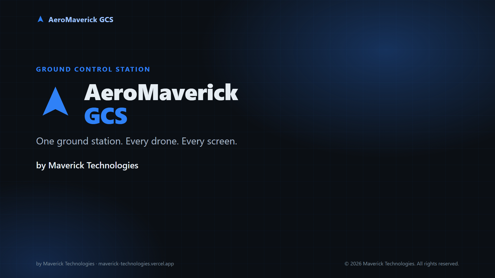
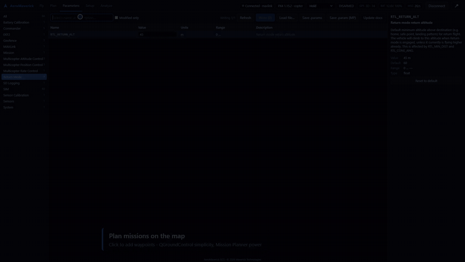
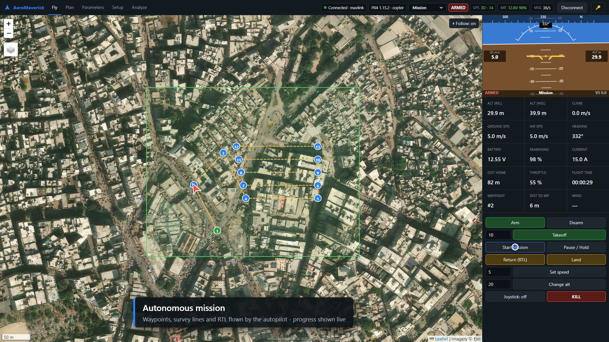
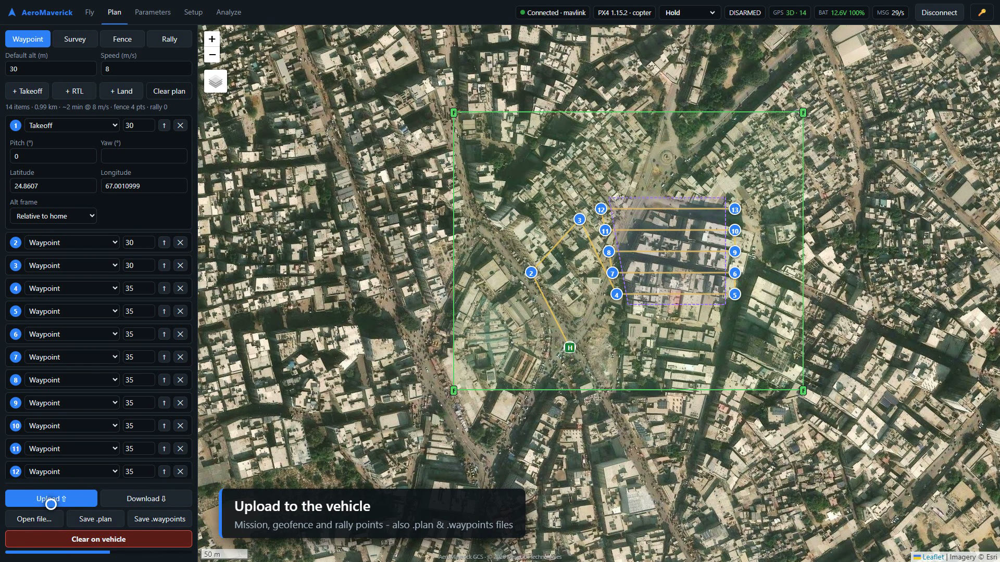
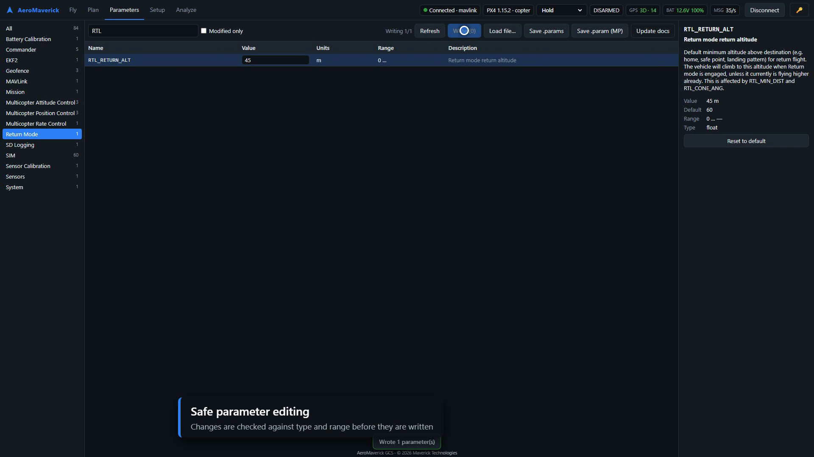
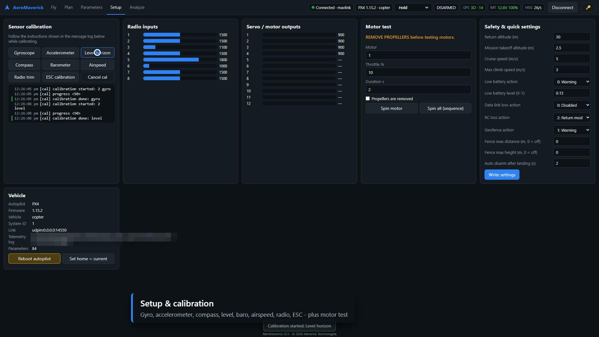
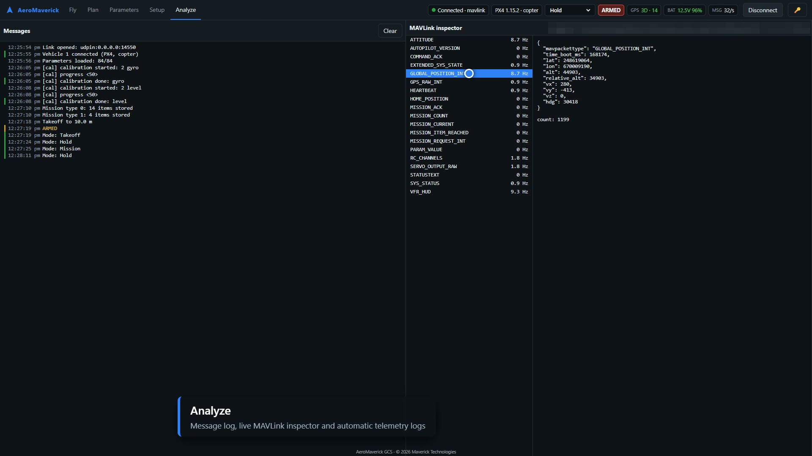
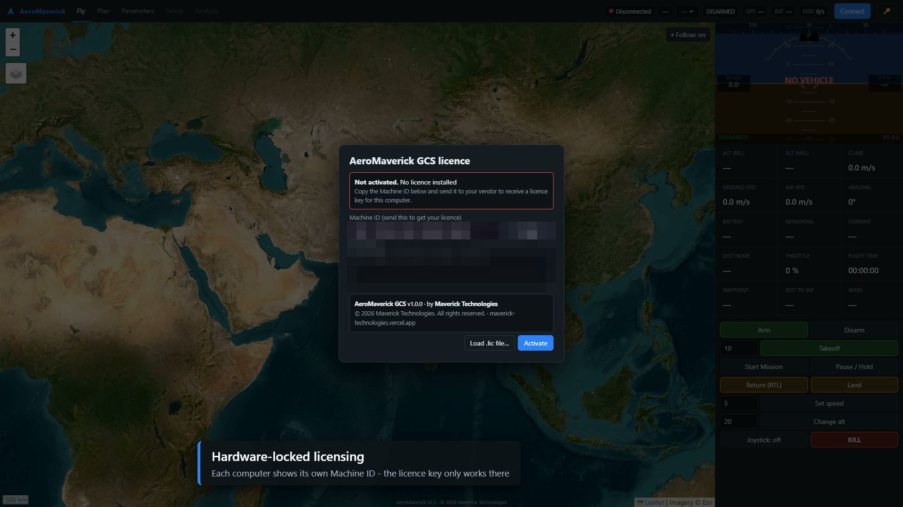
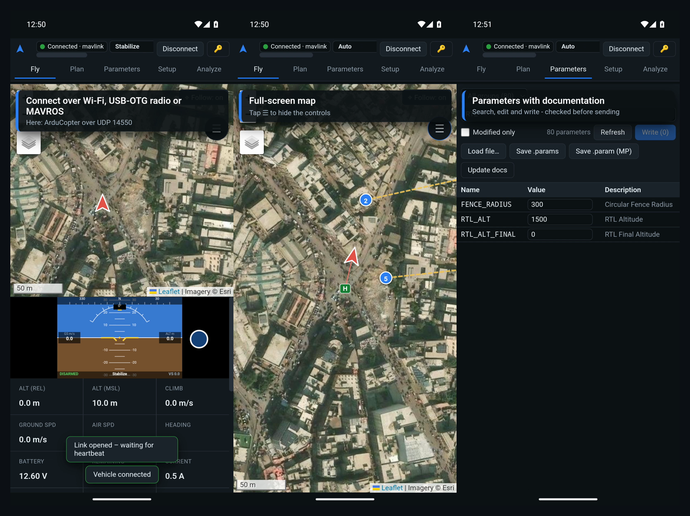

<h1 align="center">AeroMaverick GCS</h1>

<b>One ground station. Every drone. Every screen.</b> 
by <a href="https://maverick-technologies.vercel.app">Maverick Technologies</a>

  <a href="https://github.com/UnknownEng/AeroMaverick-GCS/releases/latest"><b>⬇ Download for Windows</b></a> &nbsp;·&nbsp;
  <a href="https://github.com/UnknownEng/AeroMaverick-GCS/releases/latest"><b>⬇ Download for Android</b></a> &nbsp;·&nbsp;
  <a href="https://github.com/UnknownEng/AeroMaverick-GCS/releases/latest/download/AeroMaverick-GCS-Pitch.mp4">▶ Pitch video (2 min)</a> &nbsp;·&nbsp;
  <a href="https://github.com/UnknownEng/AeroMaverick-GCS/releases/latest/download/AeroMaverick-GCS-Full-Demo.mp4">▶ Full demo (5 min)</a>

AeroMaverick GCS is a professional ground control station for **PX4** and **ArduPilot** aircraft, rovers, boats and subs. It
combines the depth of Mission Planner with the simplicity of QGroundControl. It connects **directly over MAVLink** or
**through MAVROS (ROS 1 and ROS 2)**, and the same engine runs on **Windows** and **Android**.

## Highlights

| | |
|---|---|
| **Connect** | MAVLink 2 over UDP, TCP, serial, USB telemetry radios and **USB-OTG on phones**, or **MAVROS** on ROS 1 / ROS 2 via rosbridge. PX4 vs ArduPilot and the vehicle type are detected automatically. |
| **Fly** | Satellite / street / topo maps, artificial horizon HUD, 15 live telemetry tiles, one-tap arm, takeoff, mission, hold, RTL and land, *go to here*, ROI, set home, joystick control, emergency stop. |
| **Plan** | Click-to-add waypoints, 20+ mission commands, **survey grid generator**, **geofence**, **rally points**. Opens and saves QGroundControl `.plan` and Mission Planner `.waypoints` files. |
| **Parameters** | The official PX4 and ArduPilot documentation is built in: descriptions, units, ranges, dropdowns, bitmask editor and defaults. Values are checked against type and range before they are written. Load files with a diff preview; save `.params` / `.param`. |
| **Setup** | Gyro, accelerometer (incl. ArduPilot 6-position), compass with progress, level, baro, airspeed, radio trim, ESC calibration, RC and servo monitors, motor test, failsafe quick settings. |
| **Analyze** | Colour-coded message log, live MAVLink inspector, automatic `.tlog` telemetry recording. |
| **Licensing** | Offline, hardware-locked, cryptographically signed licences, in Basic, Pro and Enterprise editions. |

## Screenshots

| Fly | Plan |
|---|---|
|  |  |
| **Parameters** | **Setup & calibration** |
|  |  |
| **Analyze** | **Licence activation** |
|  |  |

**Android**

## Download & install

Go to **[Releases](https://github.com/UnknownEng/AeroMaverick-GCS/releases/latest)**:

| File | Platform |
|---|---|
| `AeroMaverick-GCS-Windows.zip` | Windows 10 / 11 (64-bit). Unzip it and run `AeroMaverick GCS.exe`. Nothing to install. |
| `AeroMaverick-GCS-1.0.0.apk` | Android 8.0+ (64-bit phones / tablets). Open it on the phone and allow "install unknown apps". |
| `SHA256SUMS.txt` | Checksums to verify your download |

Then:

1. Start the app. The licence screen shows your device's **Machine ID**.
2. Send the Machine ID to Maverick Technologies to get your licence key.
3. Paste the key (or load the `.lic` file) and press **Activate**.

The full guide, including connection setups for SITL, Pixhawk USB, SiK/RFD radios, Wi-Fi and MAVROS, is in **[docs/USER_GUIDE.md](docs/USER_GUIDE.md)**.

## Editions

| | Basic | Pro | Enterprise |
|---|:-:|:-:|:-:|
| MAVLink (UDP / TCP / serial / USB-OTG) | ✔ | ✔ | ✔ |
| Fly, Plan, Parameters | ✔ | ✔ | ✔ |
| MAVROS (ROS 1 / ROS 2) | | ✔ | ✔ |
| Survey, geofence & rally | | ✔ | ✔ |
| Setup & calibration, MAVLink inspector, joystick | | ✔ | ✔ |
| Multi-vehicle features (roadmap) | | | ✔ |

For licences, pricing and support, visit **[maverick-technologies.vercel.app](https://maverick-technologies.vercel.app)**.

## Quality

Every build runs **171 automated end-to-end checks** against simulated PX4 and ArduPilot vehicles and simulated MAVROS
(ROS 1 + ROS 2). They cover every connection type, every calibration, every parameter type, missions, geofence and
rally points, the full flight sequence and licence security, on both Windows and Android.

> ⚠️ **Safety.** Unmanned aircraft are dangerous. Always do a props-off bench test after changing parameters or
> calibrating, and fly within the law and your local regulations.

---

<b>AeroMaverick GCS</b> is a product of <b>Maverick Technologies</b>. 
© 2026 Maverick Technologies. All rights reserved. See <a href="LICENSE">LICENSE</a>. 
The source code is proprietary and is not published in this repository.

